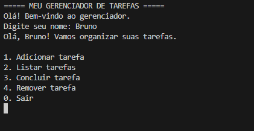

# Gerenciador de Tarefas 📋

Aplicação de console em Python para organizar tarefas do dia a dia. Permite cadastrar, listar, concluir e remover tarefas por meio de um menu interativo no terminal.

## Funcionalidades

- **Adicionar tarefa** — cadastra uma nova tarefa com status pendente
- **Listar tarefas** — exibe todas as tarefas numeradas, com indicador visual de status (`☐` pendente / `☑` concluída)
- **Concluir tarefa** — marca uma tarefa como concluída pelo índice
- **Remover tarefa** — exclui uma tarefa da lista pelo índice

## Requisitos

- [Python 3.6+](https://www.python.org/downloads/) (o projeto não usa bibliotecas externas)

## Como executar

Clone o repositório e execute o arquivo `main.py`:

```bash
git clone <URL_DO_REPOSITORIO>
cd python-todo-list
python main.py
```

No Linux/macOS, dependendo da instalação, use:

```bash
python3 main.py
```

## Como usar

Ao iniciar, a aplicação pede seu nome e exibe o menu principal:



A partir daí, basta digitar o número da operação desejada e pressionar `Enter`.

### Adicionar tarefa (opção 1)

Informe a descrição da tarefa quando solicitado:


### Listar tarefas (opção 2)

As tarefas são exibidas com o índice e o status: `☐` para pendente e `☑` para concluída.


### Concluir tarefa (opção 3)

Digite o índice da tarefa que deve ser marcada como concluída:


Após a conclusão, a listagem mostra o novo status:


### Remover tarefa (opção 4)

Digite o índice da tarefa que deve ser excluída da lista:


> **Atenção:** os índices exibidos na listagem começam em `0`. Para sair, escolha a opção `0`.

## Estrutura do projeto

```
python-todo-list/
├── main.py               # Código-fonte completo da aplicação
├── README.md
└── assets/
    ├── menu.png          # Print do menu principal
    ├── inserir uma tarefa.png
    ├── listar tarefas.png
    ├── concluir tarefa.png
    ├── listar tarefas 2.png
    └── remover tarefas.png
```

O arquivo contém a classe `Tarefa` (nome e status) e o laço principal com o menu de operações.

## Observações e limitações

- As tarefas ficam **apenas em memória**: ao encerrar o programa, a lista é perdida.
- Não há tratamento de entradas inválidas — digitar letras no menu ou índices fora da lista encerra o programa com erro.
- O terminal é limpo (`cls` no Windows, `clear` no Linux/macOS) a cada operação.
- Uma tarefa só pode ser marcada como concluída; não é possível desmarcá-la.

## Possíveis melhorias

- Persistir as tarefas em arquivo (JSON, CSV) ou banco de dados (SQLite)
- Validar entradas e tratar índices inválidos
- Permitir desmarcar e editar tarefas
- Extrair o menu e as operações para funções separadas
- Adicionar testes automatizados
